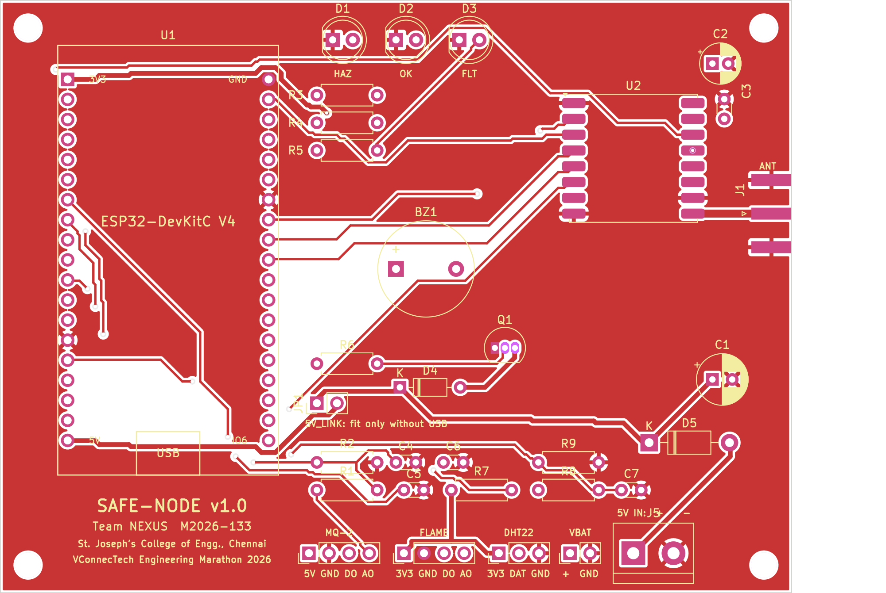
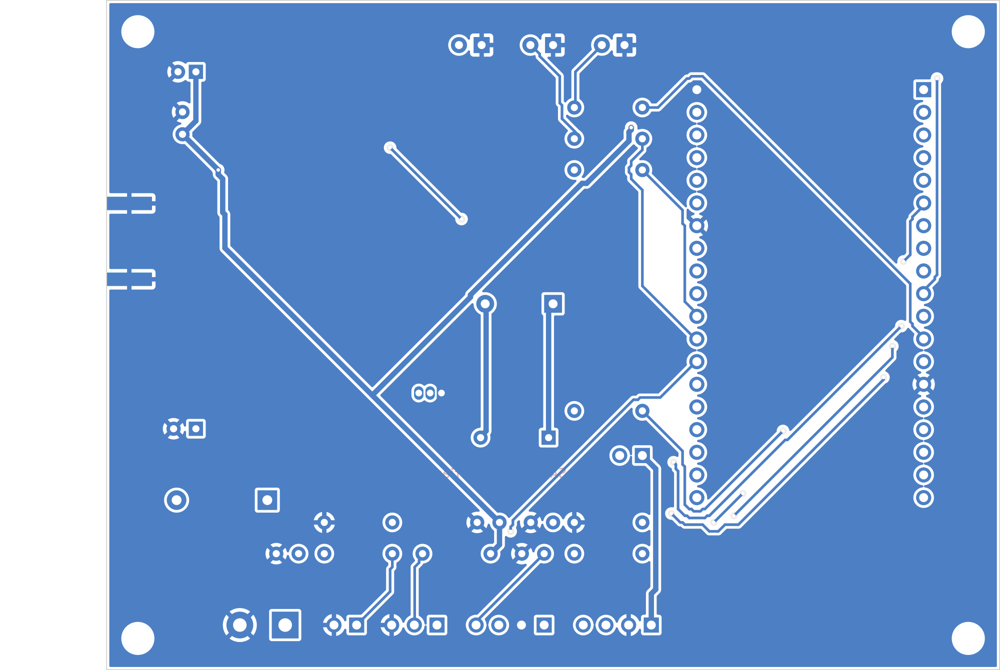

# SAFE-NODE — Fail-Safe Real-Time Gas and Fire Safety Network

**Team NEXUS · Team ID M2026-133 · St. Joseph's College of Engineering, Chennai**
VConnecTech Engineering Marathon 2026

SAFE-NODE is a low-cost gas, flame and heat safety network built on the ESP32. Its design rule is that **the system must never fail silently**. An unplugged sensor, a hung controller or a dead radio link is reported as a fault or an offline node, never as "safe".

> **Safety notice.** SAFE-NODE is a student prototype. It is not a certified gas detector (IS/IEC 60079-29-1) or fire alarm (IS 2189), and it must not replace one.

## Documents

| Document | Standard followed | Contents |
|---|---|---|
| [`docs/M2026-133_FailSafeGasFireNetwork_DPR.pdf`](docs/M2026-133_FailSafeGasFireNetwork_DPR.pdf) | Marathon DPR template, IEEE two-column | Problem, objectives O1–O6, design, plan, results |
| [`docs/M2026-133_SAFE-NODE_Technical_Documentation.pdf`](docs/M2026-133_SAFE-NODE_Technical_Documentation.pdf) | IEEE Std 1016 (design), IEEE Std 829 (test) | Schematic, PCB, pin map, BOM, firmware, protocol, test log, anomaly reports |
| [`docs/SRS.md`](docs/SRS.md) | ISO/IEC/IEEE 29148 | Requirements with IDs, traced to objectives and test cases |
| [`test/test-plan.md`](test/test-plan.md) | IEEE Std 829 | Test plan and test case specifications |
| [`test/logs/`](test/logs/) | IEEE Std 829 | Dated test logs and incident reports |
| [`hardware/README.md`](hardware/README.md) | IEEE Std 315, IPC-2221B | KiCad project, fabrication and assembly notes |
| [`docs/references.bib`](docs/references.bib) | IEEE reference style | Bibliography in BibTeX |

## Status (25 November 2026)

| Part | Status |
|---|---|
| Node circuit | Simulated in LabWired. See [`simulation/`](simulation/) |
| Carrier PCB rev 1.0 | KiCad 7 schematic and 2-layer layout complete. DRC shows 0 unconnected pads and 0 clearance errors. Gerbers are ready but no board has been built yet |
| Firmware v0.1 (Arduino) | Runs in simulation. Gas and flame inputs are sampled; a hazard turns on the red LED and buzzer, and a fault turns on the yellow LED |
| Firmware v1.0 (ESP-IDF, FreeRTOS, watchdog, LoRa) | Code complete; builds with ESP-IDF v5.2.3 (no warnings); decision logic unit-tested on a PC. **Not yet run on hardware** |
| Gateway firmware | Code complete; builds with ESP-IDF v5.2.3 (no warnings); node table unit-tested. **Not yet run on hardware** |
| Host: MQTT bridge, SQLite, dashboard, SMS | Complete and tested end to end against a gateway emulator. Not yet run with a real gateway |
| Bench tests TC-1 to TC-9 | Planned for the Implementation Round; scripts in [`test/scripts/`](test/scripts/) |

Open issues are tracked as AR-1 … AR-12 in Section VI-E of the technical documentation. AR-1 and AR-8 are closed in the PCB. AR-2 to AR-7 and AR-10 are addressed in the firmware v1.0 code; they stay open until the bench tests confirm the fixes. Before powering real hardware, read [`hardware/README.md`](hardware/README.md).

## Simulation

| Project | Link |
|---|---|
| `final`: complete node circuit | https://app.labwired.com/p/dharshinir2028/b2b2b0950f8219b71e729534c77f84a7 |
| `final_slider_monitor`: same circuit with slide potentiometers on GPIO32/33 | https://app.labwired.com/p/963436e296210af24c3ec1ab57304f01 |

How to run it and what was verified: [`simulation/README.md`](simulation/README.md).

## Hardware at a glance

| Signal | ESP32 pin | Notes |
|---|---|---|
| MQ-2 AO | GPIO32 (ADC1_CH4) | Through an R1 = 12 kΩ / R2 = 10 kΩ divider (5 V → 2.27 V) |
| Flame AO | GPIO33 (ADC1_CH5) | Module powered from 3V3 |
| DHT22 DATA | GPIO4 | R7 = 10 kΩ pull-up. Read at most once every 2 s |
| Buzzer | GPIO13 | PN2222A low-side driver, R6 = 1 kΩ, D4 flyback |
| LED red / green / yellow | GPIO14 / 16 / 17 | 220 Ω each, for hazard / healthy / fault |
| Battery sense | GPIO35 (ADC1_CH7) | 100 kΩ / 100 kΩ divider |
| RFM95W (SX1276) LoRa | SCK 18, MISO 19, MOSI 23, NSS 5, RST 27, DIO0 26 | 865–867 MHz only (India licence-exempt band) |

Board: 100 × 75 mm, 2 layers. Indicative cost is about ₹2,460 per node (see [`hardware/fab/safe-node-bom.csv`](hardware/fab/safe-node-bom.csv)).

<p align="center"> </p>

## Quick start (no hardware needed)

```bash
git clone <this repository> && cd safe-node-m2026-133
python3 -m venv .venv && source .venv/bin/activate    # Windows: .venv\Scripts\activate
pip install -r host/requirements-dev.txt
make test        # firmware unit tests (gcc) + host tests (pytest)
make budget      # reproduce the analytical figures of DPR Table X
make demo        # host + emulated gateway with three nodes -> http://127.0.0.1:5000
```

Without `make` (for example on Windows): `cd host && python -m pytest -q`, then `python -m safenode_host --demo --no-mqtt`.

## Repository layout

```
.
├── docs/                 DPR, technical documentation, SRS, figures, references.bib
├── hardware/
│   ├── kicad/            KiCad 7 project (schematic, PCB, symbols, footprints, netlist)
│   ├── fab/              Gerber X2 + Excellon, zipped Gerbers, BOM, placement file
│   ├── plots/            Schematic PDF/PNG, PCB top/bottom/assembly renders
│   └── reports/          KiCad DRC report
├── simulation/           LabWired project links, run procedure, screenshots
├── firmware/
│   ├── node/v0.1/        Arduino prototype (as simulated in LabWired)
│   ├── node/v1.0/        ESP-IDF + FreeRTOS target firmware
│   ├── gateway/          Gateway ESP32 + SX1276
│   ├── components/       Shared: frame protocol, SX1276 driver, board pin map
│   └── test/             Unit tests for the firmware logic (run on a PC)
├── host/                 Serial→MQTT bridge, SQLite, Flask dashboard, SMS queue, gateway emulator
├── test/                 Test plan, dated test logs, log template, test scripts, protocol vectors
├── tools/                DPR budget calculator, vector generator, pcbgen (schematic/PCB generator)
├── .github/              CI workflow, anomaly-report and change-request templates
├── Makefile              test / demo / budget / node / gateway targets
├── LICENSES/             Full licence texts
├── CITATION.cff  CHANGELOG.md  CONTRIBUTING.md  CODE_OF_CONDUCT.md
```

## Dependencies

| Part | Tools and libraries |
|---|---|
| Firmware v0.1 | Arduino IDE 2, *esp32* board package by Espressif |
| Firmware v1.0, gateway | ESP-IDF v5.2 or later (includes FreeRTOS); CI uses v5.2.3 |
| Firmware unit tests | A C99 compiler (`gcc` or `clang`) and `make` |
| Host | Python 3.10+, packages in [`host/requirements.txt`](host/requirements.txt) (`paho-mqtt`, `flask`, `pyserial`, `requests`); Mosquitto MQTT broker (optional); Twilio account for SMS (optional) |
| Hardware | KiCad 7 or later |
| `tools/pcbgen` | KiCad 7 `pcbnew` Python module, Python 3.10+, `numpy` |
| Simulation | Web browser (LabWired, links above) |

## Build and run

**Firmware v0.1 (Arduino):** see [`firmware/node/v0.1/README.md`](firmware/node/v0.1/README.md). In Arduino IDE 2, install the *esp32* board package, open `firmware/node/v0.1/main/main.ino`, select *ESP32 Dev Module* and upload. Serial Monitor at 115200 baud; test commands `G<n>`, `F<n>`, `T<n>`, `H<n>`, `X`/`Y`/`Z`, `R`, `?`.

**Firmware v1.0 and gateway (ESP-IDF v5):**
```bash
. $IDF_PATH/export.sh
cd firmware/node/v1.0             # set a unique node ID in menuconfig -> "SAFE-NODE node"
idf.py set-target esp32
idf.py menuconfig
idf.py build flash monitor
cd ../../gateway && idf.py set-target esp32 build flash
```
Details: [`firmware/node/v1.0/README.md`](firmware/node/v1.0/README.md), [`firmware/gateway/README.md`](firmware/gateway/README.md).

**Host:**
```bash
cd host && pip install -r requirements.txt
python bridge.py --port /dev/ttyUSB0 --config config.example.json     # dashboard at http://127.0.0.1:5000
```
Details: [`host/README.md`](host/README.md).

**Hardware:** open `hardware/kicad/safe-node.kicad_pro` in KiCad 7 or later. To order boards, send `hardware/fab/safe-node-gerbers.zip` to any PCB maker. Settings: 2 layers, 1.6 mm FR-4, HASL.

**Continuous integration:** every push runs the unit tests, checks the protocol vectors and the DPR budget, builds both ESP-IDF projects with ESP-IDF v5.2.3, and compiles the v0.1 sketch ([`.github/workflows/ci.yml`](.github/workflows/ci.yml)).

## Requirement coverage in code

| Objective | Requirements | Implemented in | Verified by (today) |
|---|---|---|---|
| O1 local alarm | FR-01, FR-03–FR-06, PR-01 | `firmware/node/v1.0/main/classifier.c`, `main.c` (sensor, alarm tasks) | `firmware/test/test_classifier.c`; SIM-2 (v0.1) |
| O2 remote alert | FR-22–FR-25, PR-02 | `firmware/node/v1.0/main/radio.c`, `firmware/gateway/`, `host/` | `host/tests/`; analysis `tools/lora_budget.py` |
| O3 offline detection | FR-20, FR-21 | `heartbeat_task`, `firmware/gateway/main/node_table.c` | `test_node_table.c`, `host/tests/test_end_to_end.py` |
| O4 hang recovery | FR-14, FR-15 | `health_task` (conditional watchdog feed), RTC reset counter, NVS event ring | TC-4 on the bench (planned) |
| O5 sensor faults | FR-02, FR-10–FR-13 | `classifier.c`, `selftest.c`, `dht22.c` | `test_classifier.c` |
| O6 cost, backup, isolation | FR-16, PR-03, PR-04, HR-06 | Task priorities and core pinning, low-battery rule | BOM; `tools/lora_budget.py`; TC-6, TC-8 (planned) |

## Team

| Member | Role |
|---|---|
| Dharshini R (Team Lead) | Firmware, RTOS, watchdog, test lead |
| Dheekshitha R | Hardware, power, sensor interfacing |
| Aswin Roch J | LoRa / ESP-NOW, protocol, gateway |
| Anto Prisin D | MQTT bridge, dashboard, SMS |

## Licence

| Part | Licence |
|---|---|
| Firmware, host software, `tools/` | MIT ([`LICENSE`](LICENSE)) |
| Hardware design files (`hardware/`) | CERN-OHL-P-2.0 ([`LICENSES/CERN-OHL-P-2.0.txt`](LICENSES/CERN-OHL-P-2.0.txt)) |
| Documentation (`docs/`, `test/`, `simulation/`) | CC BY 4.0 ([`LICENSES/CC-BY-4.0.txt`](LICENSES/CC-BY-4.0.txt)) |

To cite this work, see [`CITATION.cff`](CITATION.cff).
