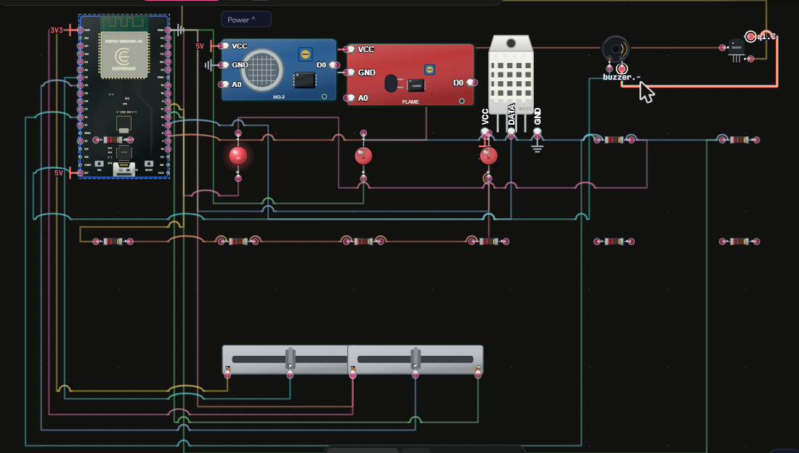

# Simulation (LabWired)

The sensor node was simulated in LabWired before the PCB was designed.

| Project | Link | Contents |
|---|---|---|
| `final` | https://app.labwired.com/p/dharshinir2028/b2b2b0950f8219b71e729534c77f84a7 | Complete node circuit: ESP32 DevKitC, MQ-2, flame sensor, DHT22, buzzer driver, LEDs |
| `final_slider_monitor` | https://app.labwired.com/p/963436e296210af24c3ec1ab57304f01 | Same circuit with two 10 kΩ slide potentiometers on GPIO32/33. LabWired models the MQ-2 and flame modules as pin-only parts, so the sliders stand in for their analog outputs. Firmware v0.1 (`src/main.ino`) |

## How to run

1. Open `final_slider_monitor` and press **Run**. The first boot takes about a minute.
2. Click the ESP32 and open the **Serial** tab.
3. Move both sliders to full scale (4095 counts). Within one firmware cycle the monitor prints `[ALERT] GAS LEAKAGE DETECTED`, `[ALERT] FLAME DETECTED`, `[OUTPUT] RED LED ON` and `[OUTPUT] BUZZER ON`.
4. Move both sliders below 1800 counts to return to NORMAL. Type `X` to inject a gas-sensor fault (yellow LED).

The simulator runs about 420 times slower than real time. One 200 ms firmware cycle takes about 85 s on screen, so judge behaviour here and measure timing on hardware.

## Results

The 22 November 2026 run is logged in [`../test/logs/2026-11-22_labwired_sim.md`](../test/logs/2026-11-22_labwired_sim.md): SIM-1 to SIM-4 passed, and SIM-5 and SIM-6 are open. Twelve anomaly reports (AR-1 to AR-12) were raised. AR-1 (MQ-2 output not divided) and AR-8 (base resistor, LED colours) are closed in the PCB. The `final` project still needs the divider added to match the hardware.

## Exporting the firmware

To keep the repository in step with the simulation, open the project's code editor and copy `src/main.ino` to `firmware/node/v0.1/main/main.ino`. Commit it with the date of the export.
